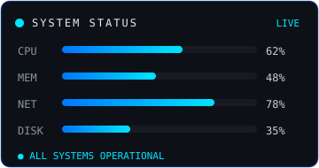

<div align="center">

# SANDEEP S RAJESH

### IT Administrator &nbsp;|&nbsp; Linux System Engineer &nbsp;|&nbsp; AWS Cloud Enthusiast &nbsp;|&nbsp; DevOps Engineer

[](https://git.io/typing-svg)

[](https://www.linkedin.com/in/sandeep-s-rajesh-424b8b224/)
[](https://github.com/skullace-25)
[](mailto:avusandeep@gmail.com)


</div>

## 💻 Try the Live Terminal

<div align="center">

[](https://skullace-25.github.io/terminal-intro)

**An interactive terminal intro — type commands like `whoami`, `skills`, `projects`, or click the command chips. Runs in your browser, no install needed.**

</div>

---

## 👤 About Me



System Engineer with **4+ years of experience** in IT infrastructure and system administration across manufacturing and fintech environments. I design, deploy, and maintain reliable systems — from Linux servers and Windows environments to networks, firewalls, and backup & recovery.

I am now transitioning into **Cloud Engineering and DevOps**, building hands-on skills in AWS, Docker, Kubernetes, and Infrastructure as Code, and documenting the journey with practical labs and projects on this profile.

**What I work with every day**

- 🖥️ **IT infrastructure & system administration** — servers, endpoints, and business-critical systems
- 🐧 **Linux & Red Hat Enterprise Linux** — administration, users & permissions, LVM, filesystems
- 🪟 **Windows Server administration** — deployment, accounts, and support
- 🌐 **Network configuration & troubleshooting** — TCP/IP, DNS, DHCP, VLAN, VPN
- ☁️ **Cloud computing & AWS** — EC2, S3, IAM, VPC, Route 53, CloudWatch
- ⚙️ **DevOps tools & automation** — Docker, Kubernetes, Jenkins, Ansible, Terraform, GitHub Actions
- 🛡️ **Infrastructure security & monitoring** — firewalls, access control, Grafana, Prometheus
- 📚 **Continuous learning** — RHCSA training and hands-on technical projects

**Currently:** Intern — IPSR Solutions Limited (Sep 2026 – Present) · **Education:** BSc Computer Science, Mahatma Gandhi University (2018–2021)

<br clear="right"/>

---

## 🛠️ Technical Skills

### System Administration

<div align="left">

[](https://skillicons.dev)

</div>


Linux · Red Hat Enterprise Linux · Windows Server · SSH · Bash Scripting · User & Permission Management · LVM · Filesystem Management · NFS · AutoFS · System Monitoring

### Cloud — AWS

[](https://skillicons.dev)


AWS · EC2 · S3 · IAM · VPC · Route 53 · CloudWatch

### DevOps

[](https://skillicons.dev)


Git · GitHub · Docker · Kubernetes · Jenkins · Ansible · Terraform · GitHub Actions · CI/CD

### Networking & Security


TCP/IP · DNS · DHCP · VLAN · VPN · Firewalls · SonicWall · Network Troubleshooting · Security Auditing

### Monitoring

[](https://skillicons.dev)


Grafana · Prometheus · Nagios · Zabbix

### 📊 Proficiency — Honest Levels

| Technology | Level | Notes |
| --- | --- | --- |
| Linux / RHEL | ●●●●○ Proficient | Daily administration, 4+ years |
| Windows Server | ●●●●○ Proficient | Deployment, accounts, support |
| Bash / SSH | ●●●●○ Proficient | Scripting & remote administration |
| Networking (TCP/IP, DNS, DHCP, VPN) | ●●●●○ Proficient | Config & troubleshooting |
| Firewalls / SonicWall | ●●●●○ Proficient | Rules, VPN, access control |
| LVM / Filesystems / NFS | ●●●○○ Working | Regular hands-on use |
| Git / GitHub | ●●●○○ Working | Daily version control |
| Docker | ●●●○○ Working | Learning — containerizing apps |
| AWS (EC2, S3, IAM, VPC) | ●●○○○ Learning | Currently training |
| Kubernetes | ●●○○○ Learning | Minikube labs in progress |
| Terraform / Ansible | ●●○○○ Learning | IaC labs in progress |
| Jenkins / GitHub Actions | ●●○○○ Learning | CI/CD labs in progress |
| Grafana / Prometheus | ●●○○○ Learning | Monitoring labs in progress |
| Nagios / Zabbix | ●○○○○ Exploring | Evaluating |

---

## 🚀 Featured Projects

> Project repositories are placeholders until the actual labs are published. Each card will link to its real repository as it goes live.

<table>
<tr>
<td width="50%">

### 🐧 Linux System Administration
**`linux-admin-toolkit`** — Planned
Bash scripts for user management, disk usage checks, service health monitoring, and routine admin tasks.
<br>🔧 `Bash` `Linux` `systemd`
<br>🔗 Repository: coming soon

</td>
<td width="50%">

### 🎓 RHCSA Practical Labs
**`rhcsa-labs`** — 🟢 In Progress
Hands-on RHEL 10 labs covering users & permissions, LVM, systemd, networking, firewalld, and SELinux.
<br>🔧 `RHEL 10` `LVM` `firewalld` `SELinux`
<br>🔗 Repository: coming soon

</td>
</tr>
<tr>
<td width="50%">

### ☁️ AWS Cloud Infrastructure
**`aws-infrastructure`** — Planned
Reference AWS setup: custom VPC, EC2 web server, S3 storage, IAM roles with least-privilege policies.
<br>🔧 `EC2` `VPC` `S3` `IAM`
<br>🔗 Repository: coming soon

</td>
<td width="50%">

### 🔐 Network Configuration & Security
**`network-security-lab`** — Planned
VLAN segmentation, VPN setup, firewall rule documentation, and a network troubleshooting runbook.
<br>🔧 `VLAN` `VPN` `SonicWall` `TCP/IP`
<br>🔗 Repository: coming soon

</td>
</tr>
<tr>
<td width="50%">

### 🐳 Docker & Containerization
**`docker-labs`** — Planned
Containerized web applications with Docker and Compose — images, volumes, networks, and best practices.
<br>🔧 `Docker` `Compose` `Nginx`
<br>🔗 Repository: coming soon

</td>
<td width="50%">

### 🔄 CI/CD Automation
**`cicd-pipelines`** — Planned
CI/CD pipelines with GitHub Actions — build, test, and deploy workflows for sample applications.
<br>🔧 `GitHub Actions` `Jenkins` `CI/CD`
<br>🔗 Repository: coming soon

</td>
</tr>
<tr>
<td width="50%">

### 🏗️ Infrastructure as Code
**`terraform-aws`** — Planned
Terraform modules for repeatable AWS infrastructure — VPC, EC2, and S3 with variables and outputs.
<br>🔧 `Terraform` `AWS` `IaC`
<br>🔗 Repository: coming soon

</td>
<td width="50%">

### 🛡️ Cybersecurity & System Auditing
**`security-audit-toolkit`** — Planned
System auditing checklists and scripts — permissions review, open ports, failed logins, and hardening steps.
<br>🔧 `Bash` `Audit` `Hardening`
<br>🔗 Repository: coming soon

</td>
</tr>
</table>

---

## 📈 GitHub Analytics

<div align="center">


</div>

> Analytics cards are live and fill in as repositories and contributions grow. The snake is generated daily by a GitHub Action (`.github/workflows/snake.yml`) and appears after its first run. If any external stats service is temporarily unavailable, its card simply won't render — remove that image line to hide it.

---

## 📚 Currently Learning

```text
$ tail -f learning.log
[....] Advanced Linux Administration
[....] RHCSA — RHEL 10
[....] AWS Cloud Infrastructure
[....] Docker and Kubernetes
[....] Terraform and Ansible
[....] DevOps CI/CD
[....] Cloud Security
```

- 🎯 **RHCSA** (Red Hat Certified System Administrator) — *in progress*, IPSR Solutions Limited, 2026
- 🧪 **Software Testing Specialist** — Luminar Technolab, Ernakulam, 2021–2022

---

## 📬 Contact

<div align="center">

[](https://www.linkedin.com/in/sandeep-s-rajesh-424b8b224/)
[](https://github.com/skullace-25)
[](mailto:avusandeep@gmail.com)


</div>

```bash
$ ./contact.sh
email     : avusandeep@gmail.com
linkedin  : linkedin.com/in/sandeep-s-rajesh-424b8b224
github    : github.com/skullace-25
portfolio : coming soon
location  : Kerala, India
status    : open to opportunities
```

---


